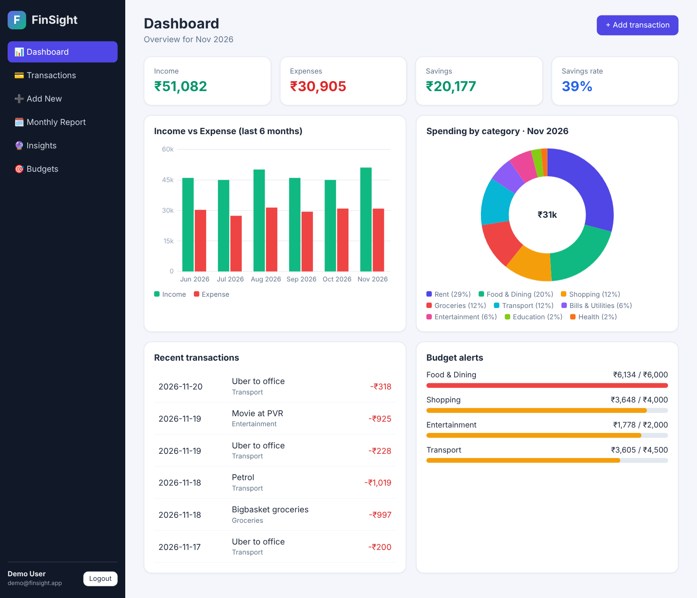
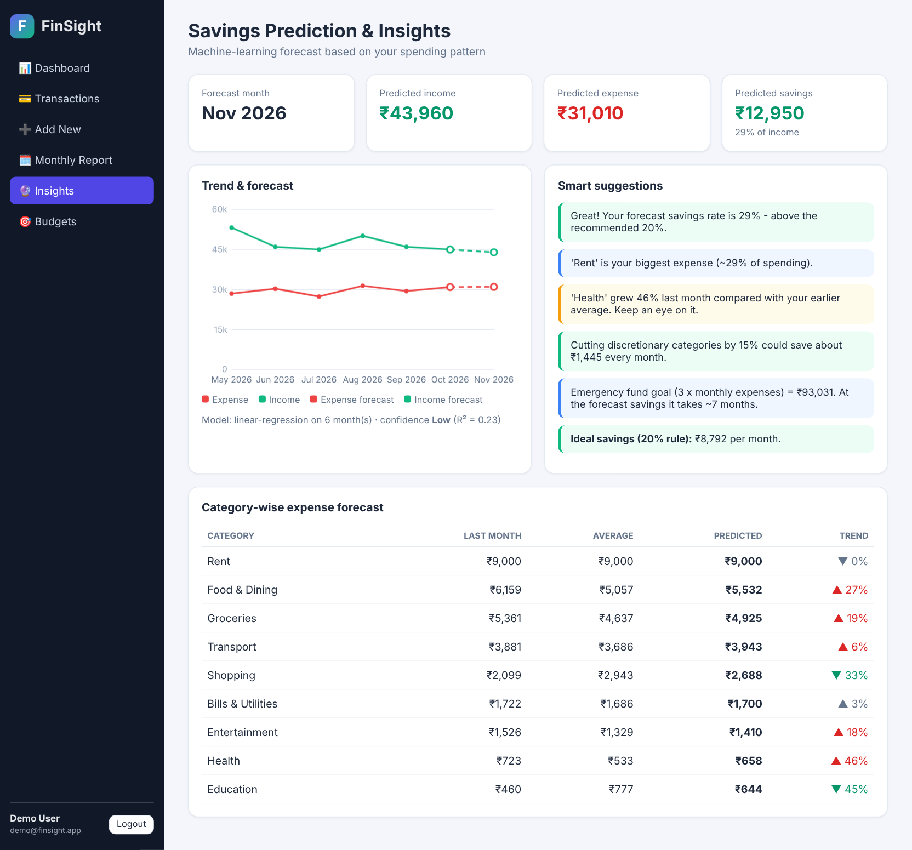

# FinSight – Personal Finance & Expense Intelligence System

A Python/Flask web application that **tracks income & expenses, auto-categorises spending, builds monthly reports
and predicts next month's savings** using Linear Regression.

| Dashboard | Insights (prediction) |
|---|---|
|  |  |

## Features
- Register / login (hashed passwords, sessions, CSRF protection)
- Add, edit, delete, search, filter transactions + CSV export
- **Auto-detect category** from the description ("Swiggy dinner" → Food & Dining)
- Dashboard with 6-month income vs expense chart and category doughnut chart
- **Monthly report**: category split, daily spending, top 5 expenses, month-over-month change, unusual-expense alerts
- **Savings prediction**: Linear Regression (scikit-learn) on past months + category-wise weighted moving average
- Smart suggestions (savings rate, 50/30/20 rule, fastest growing category, emergency-fund goal)
- Budgets per category with progress bars

## Tech stack
Python 3.10+, Flask, SQLite, NumPy, scikit-learn, Jinja2, vanilla JS (canvas charts), Gunicorn.

## Run locally
```bash
git clone https://github.com/<your-username>/finsight.git
cd finsight
python -m venv venv
venv\Scripts\activate          # Windows   (Linux/macOS: source venv/bin/activate)
pip install -r requirements.txt
python seed_demo.py            # optional: 8 months of demo data
python app.py                  # open http://127.0.0.1:5000
```
Demo login (after `seed_demo.py`): **demo@finsight.app / demo1234**

## Run the tests
```bash
python -m unittest discover -s tests -v
```

## Deploy (Render – free)
GitHub only stores the code (GitHub Pages cannot run Flask), so deploy the repo on a Python host:
1. Push this folder to a GitHub repository.
2. On https://render.com → **New → Web Service** → connect the repo.
3. Build command: `pip install -r requirements.txt`  Start command: `gunicorn "app:create_app()"`
4. Add environment variable `SECRET_KEY` = any long random string.

> Note: SQLite on a free Render instance is reset on every redeploy/restart. For permanent data use a
> persistent disk or switch to PostgreSQL. (PythonAnywhere free tier keeps SQLite files permanently.)

## Regenerate the college report (PDF)
```bash
pip install -r requirements-report.txt
python seed_demo.py
python report/generate_report.py      # edit the CONFIG block at the top for name / roll no. / date
```

## Project structure
```
app.py  analytics.py  db.py  seed_demo.py
templates/  static/  tests/  docs/screenshots/  report/
```
